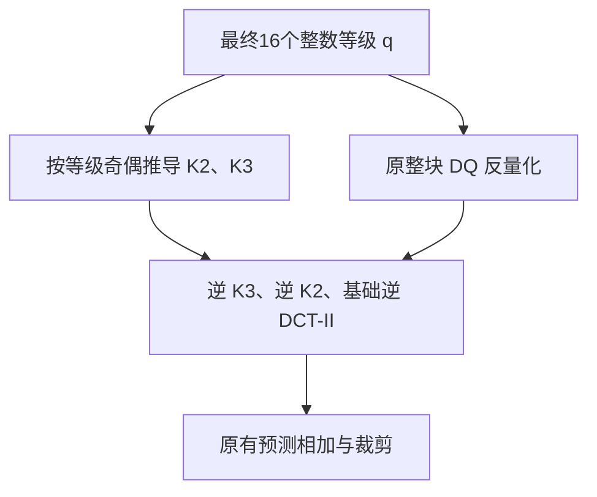

# HHI_baseline：GTT4x4 分组树变换实施方案

> 用途：交给 Codex 按阶段实现、审查和验证的工程规格。
>
> 事实基线：`zhy2249/HHI_baseline@5da139f22ffe9a281d8d9e4f0b7b4b22cba5326b`。
>
> 配置基线：仓库根目录 `cfg/*_nx2High.cfg`。核查日期：2026-10-28。
>
> 文档状态：已完成源码和配置核查、方案设计及文内数值复核；尚未实施编码器修改，未编译修改版、未运行序列编解码、未测 BD-rate。
>
> 建议入库位置：`docs/experiments/GTT4x4_nx2High_Codex_Plan.md`。本文中的新接口名称均为拟新增接口，不代表当前仓库已经存在。

阅读顺序：先用第0–1节确认范围和基线；第2–7节定义共同算法与语法；第8–9节给出DQ和编码搜索实现；第11–13节用于逐阶段落地与验收。第14节提供可直接交给执行Codex的指令，附录B/C用于回查源码。

## 0. Codex 首先执行的工作约定

1. 阅读仓库根 `AGENTS.md`、`docs/experiments/Baseline_Audit.md` 和 `docs/experiments/Getting_Started.md`，再阅读本文。
2. 核对当前提交、工作树、baseline manifest 和用户本轮的实际授权。本文以固定提交为事实；若工作区已经更新，按函数名重新定位并先解释相关差异，不强制回退、不覆盖用户修改。
3. 本任务的算法是**整块 4×4 亮度 TU（变换单元）的分组树变换**，不是 TS（变换跳过）下的四个独立 2×2 空间变换，也不是给普通 DCT 系数加一个不传信号的后处理。
4. 算法宏直接放入 `source/Lib/CommonLib/TypeDef.h`，默认关闭。CMake 负责构建与测试目标，不通过隐藏选项切换实验算法。
5. 保留当前 `ENABLE_NNLF=1` 和 `JVET_TRANSSION_DEBUG=0 / VALGRIND=1 / BUGFIX=1 / IMPROVE=1` 等既有修复。不要修改或重写 `baseline_manifest.json` 来消除实验改动造成的差异。
6. 未来用户明确要求“按本文实现”时，先完成代码、编译、合成单测和任务预览。仓库 `AGENTS.md` 明确要求：未获授权不运行任何序列级编码/解码，短帧也在此范围。没有该授权时，交付可运行命令与待验收项；不能把编译/单测写成码流验证。
7. 本文不授权上传代码、提交 PR、推送 Git、运行 CTC 或改动参考结果。是否执行这些动作以当次会话授权为准。
8. 每一阶段报告“改了什么、为什么、验证了什么、仍未验证什么”；任何简化若影响本文的解码含义、候选覆盖或关闭恢复目标，必须显式记录。

### 0.1 本版已经作出的工程决策

| 项目 | v1 决策 |
|---|---|
| 工具名 | GTT4x4，Grouped Tree Transform（分组树变换） |
| 编译宏 | `HHI_GTT4X4`，在 TypeDef.h 定义为 0 |
| 运行开关 | `GTT4x4`，默认 0；统计开关 `GTT4x4Stats`，默认 0 |
| 作用范围 | 完整的 4×4 亮度 TU；普通 `MODE_INTRA / MODE_INTER` |
| 第一版不覆盖 | 色度、非 4×4 TU、IBC、PLT、BDPCM、SBT、GTT 下的 DQ=0/2、启用缩放矩阵、无损/混合无损实验 |
| 基础变换 | 明确固定的整块 DCT-II×DCT-II；使用原整数尺度 |
| 分组 | 固定扫描中的 0–3、4–7、8–11、12–15；不是四个独立 CABAC 系数组 |
| 核库 | 恒等 I；固定 Q10 的正向 45° 旋转 R，系数 724 |
| 核控制 | 第一组最终等级奇偶控制 K2；第二组控制 K3；第四层固定 I |
| 量化 | 保留 nx2High 的 DQ=1 四物理状态；新增单 CG 受约束搜索 |
| 候选枚举 | 最多 11 个“有效核前缀×实际最后非零组”组合；全零单独处理 |
| 新模式状态 | TU 内独立的单一亮度 `bool gttFlag`；不扩展 MtsType |
| 内部路径信号 | 不显式传 K2、K3 或停止深度；从最终等级和最后位置导出 |
| 外部工具信号 | SPS 实验扩展版本 + 条件出现的一个 TU bypass bin（旁路二进制符号） |
| 符号预测 | 只对选中 GTT 的亮度 TU 关闭；旧模式和色度保持原行为 |
| 最终评分 | 完整反量化、实际整数逆变换、完整语法估价；沿用各编码入口的基线失真口径 |
| 搜索性质 | 有限候选上的近似 RDO（率失真优化），不宣称像素域全局最优 |

## 1. 已核查的真实基线与 nx2High

### 1.1 仓库身份

当前仓库已有完整文件，默认分支 `main` 在本次核查时指向：

```text
5da139f22ffe9a281d8d9e4f0b7b4b22cba5326b
Initialize fixed NextSoftware2 baseline and reproducible experiment tooling
```

这是带既有修复的 NextSoftware2 fixed baseline（固定基线快照），不能称为已证明的上游原始版本，也不能自动等同此前其他仓库的 anchor（参考版本）。本方案的源码事实均针对上述 HHI_baseline 提交，未继续以 HHI_TS_Pred 代替它。[S01] [S02]

### 1.2 主配置文件

| 运行类型 | 根目录配置 | IntraPeriod | GOPSize | 内部位深 | DQ / SDH / 符号预测 |
|---|---|---:|---:|---:|---|
| AI | `cfg/encoder_intra_nx2High.cfg` | 1 | 1 | 10 | 1 / 0 / 4 |
| RA | `cfg/encoder_randomaccess_nx2High.cfg` | 32 | 32 | 10 | 1 / 0 / 4 |
| LB | `cfg/encoder_lowdelay_nx2High.cfg` | -1 | 8 | 10 | 1 / 0 / 4 |
| LP | `cfg/encoder_lowdelay_P_nx2High.cfg` | -1 | 8 | 10 | 1 / 0 / 4 |

最后一列分别是 `DepQuant / SignHideFlag / NumSignPred`。[S03] [S04] [S05] [S06]

四套配置共同启用：

- `RDOQ=1`、`RDOQTS=1`、`DepQuant=1`：DQ（依赖量化）为四状态，不是八状态。
- `MTS=3`：显式帧内和显式帧间 MTS（多重变换选择）。不能把当前配置写成隐式 MTS。
- `IntraLFNSTISlice=1`、`IntraLFNSTPBSlice=1`、`InterLFNST=1`、`InterLFNSTSBT=1`。
- `NumSignPred=4`、`SignHideFlag=0`。符号预测与 SDH（符号隐藏）不是同一工具；SDH 已关闭，符号预测仍开启。
- `TransformSkip=1`、`TransformSkipLog2MaxSize=5`、`SBT=1`、`ChromaTS=1`、`JointCbCr=1`。

四套文件未显式设置 `ScalingList`。当前 `EncCfg.h` 默认是 `SCALING_LIST_OFF=0`；值 1 的 `default` 实际启用默认权重矩阵，不能把“默认配置未写该项”和“ScalingList=default”混为一谈。v1 要求 off/0。[S07] [S08] [S09]

### 1.3 对方案直接有影响的源码事实

1. 4×4 在 `TU::isNSPTAllowed` 的允许尺寸内。原 NST 候选在该尺寸会走 NSPT（非可分离主变换），不是一概“DCT 后的 LFNST（二次低频非可分离变换）”。GTT 与这些候选竞争，不叠加到 NSPT 后。[S10] [S11]
2. 当前主要链路把固定变换预计算与量化分开：`preCalcTrans` → `quantNxN` → `invTransformNxN`。不要照搬其他版本不存在的统一 `transformNxN(..., loadTr)` 接口。[S11] [S12]
3. `TransBuffer` 以 `MtsType` 为键，无法直接容纳同一新工具的不同路径。固定路径可以预计算，但必须有独立缓存键。[S12]
4. DQ 按反向扫描搜索；反量化也按最后非零系数到第 0 位处理。后续高扫描位置的等级会影响较低位置的反量化状态。[S13]
5. 4×4 亮度的 16 个系数恰好是一个 CABAC（上下文自适应二进制算术编码）系数组。本文的四个逻辑组不能重置 CG、DQ 或熵编码状态。[S13] [S14]

## 2. 规范算法：完整 16 维坐标与路径

### 2.1 扫描与布局

使用现有：

```cpp
g_scanOrder[SCAN_GROUPED_4x4][CoeffScanType::DIAG]
           [gp_sizeIdxInfo->idxFrom(4)][gp_sizeIdxInfo->idxFrom(4)]
```

4×4 的 raster 下标顺序应为：

```text
0, 4, 1, 8, 5, 2, 12, 9, 6, 3, 13, 10, 7, 14, 11, 15
```

生产代码调用现有扫描表；上述常量只用于断言和单元测试，不维护第二套独立扫描实现。量化前系数和最终等级仍存储在原 4×4 raster 缓冲中。旋转前 gather（按扫描收集），旋转后 scatter（回填原槽位）。

令基础变换后的扫描坐标：

\[
z_0=[e\mid a\mid b\mid h],\quad e,a,b,h\in\mathbb R^4.
\]

第 1 组直接输出 e。第 2 层处理剩余 12 维，第 3 层处理剩余 8 维，最后 4 维直接输出。

### 2.2 实数参考定义

用实数模型说明几何含义，生产实现采用下一节的整数公式：

\[
R(a,b)=\left(\frac{a+b}{\sqrt2},\frac{b-a}{\sqrt2}\right).
\]

记 \(\ u=(a+b)/\sqrt2,\ v=(b-a)/\sqrt2\ \)：

| K2 / K3 | c1 | c2 | c3 | c4 |
|---|---|---|---|---|
| I / I | e | a | b | h |
| I / R | e | a | (b+h)/√2 | (h-b)/√2 |
| R / I | e | u | v | h |
| R / R | e | u | (v+h)/√2 | (h-v)/√2 |

第二层核改变当前输出和剩余空间。不能仅评价当前四个系数的量化误差，也不能改变 K2 后保留旧的 c3/c4。

### 2.3 唯一的解码端选核规则

使用最终传输的整数等级，先按固定扫描收集 `qScan[16]`：

```cpp
p1 = (sum(abs64(qScan[i])) for i in 0..3) & 1;
p2 = (sum(abs64(qScan[i])) for i in 4..7) & 1;
k2 = p1;  // 0=I, 1=R
k3 = p2;  // 0=I, 1=R
```

- `abs64` 先提升到 int64，再求绝对值，避免极端负数的有符号溢出。
- 不使用反量化值、内部 qIdx、编码器残差、临时量化值或未传输的代价选核。
- 不对第三组施加控制第四层的奇偶约束，因为第四层固定 I。
- 变换前的真实坐标和量化等级是两个对象。修改 q2 不会把量化误差自动注入剩余坐标；它可以通过 p2 改变 K3。
- 停止用最终等级的零后缀和原 last-position 语法表达，不新增独立 STOP 语法。

## 3. 冻结整数数值契约

### 3.1 基础 DCT 保持原尺度

原 4 点 DCT-II 整数核为：

\[
T_4=
\begin{bmatrix}
64&64&64&64\\
83&36&-36&-83\\
64&-64&-64&64\\
36&-83&83&-36
\end{bmatrix}.
\]

当前内部 10 bit、普通变换动态范围 15 时，4×4 两级正向移位为 3/8，逆向为 7/10。实现使用原函数中的推导表达式，不能在量化器前替换为单位正交浮点 DCT，也不能凭经验补一个 QP 偏移。[S11] [S15] [S16] [S34]

推荐在 `TrQuant` 中新增只服务 GTT 的固定 4×4 DCT-II 正/逆包装函数，调用原 4 点 fast transform 内核和相同移位、合法裁剪位置；不经过旧 MTS/NSPT 的选择逻辑。原 `xT/xIT` 的旧路径保持不变。

### 3.2 R 核的确定性整数实现

所有加减、乘积先提升为 int64：

```cpp
// 最近舍入；恰好半格时远离 0。
int64_t roundShift10(int64_t v)
{
  // 调用前的幅度证明必须排除 INT64_MIN。
  return v >= 0 ? (v + 512) / 1024 : -((-v + 512) / 1024);
}

// 正向，两端同一实现。
u = checkedTCoeff(roundShift10(724LL * (int64_t(a) + int64_t(b))));
v = checkedTCoeff(roundShift10(724LL * (int64_t(b) - int64_t(a))));

// 规范的合成算子。不要称其为逐整数无损逆。
aHat = checkedTCoeff(roundShift10(724LL * (int64_t(u) - int64_t(v))));
bHat = checkedTCoeff(roundShift10(724LL * (int64_t(u) + int64_t(v))));
```

`checkedTCoeff` 表示先证明/检查 TCoeff 范围再转换，不表示随意饱和裁到 15 bit。最终采用的具体函数名由实现决定。

正向依次：

1. 复制根扫描坐标到路径缓冲。
2. K2=R 时，对 `(4+j,8+j), j=0..3` 成对旋转。
3. K3=R 时，对**完成第二步后的** `(8+j,12+j)` 成对旋转。
4. 回填 raster。

逆向依次：

1. 从完整 TU 的原 DQ 反量化结果收集扫描坐标。
2. 若 K3=R，先对 `(8+j,12+j)` 执行合成算子。
3. 若 K2=R，再对 `(4+j,8+j)` 执行合成算子。
4. 回填基础 DCT raster，执行明确的 DCT-II 逆包装。

### 3.3 必须保留的数值边界

- \(\ 2\times724^2/1024^2=0.999786376953125\ \)，R 近似正交；原整数 DCT 也并非精确统一范数。不能直接把正交模型的能量等式用于实际整数模式的精确裁剪或最优性证明。
- 对普通动态范围 15 的反量化输入，以 \(|d_i|\le32768\) 作保守界，逆 K3 输出界为 46336，逆 K2 输出界为 55929。原 4 点核单次累加的保守界 \(\ 4\times83\times55929=18568428\ \) 在 int32 内；原逆第一遍之后还会执行原有合法裁剪。实现者须结合当前具体 4 点实现再核对加偏置/中间变量，不能把此界无条件推广到更大块或扩展精度模式。
- 为冻结 v1 的可验证范围，GTT 开启配置要求 `InternalBitDepth=10` 且 luma `maxLog2TrDynamicRange=15`。共享适用判断检查 SPS 中相同的位深/动态范围。输入可以是正常上转换到 10 bit 的 8 bit 或 10 bit 数据；其他内部位深作为后续扩展。
- 不在旋转阶段加入额外 15-bit 裁剪；保留宽系数缓冲。反量化本身和基础逆变换的既有裁剪规则照旧。
- R(0,0)=(0,0)，I 也保持零；这是不传独立停止语法的必要条件。
- 使用定点运算，不在编解码运行路径调用 sin/cos/sqrt 或依赖浮点舍入。

### 3.4 整数黄金向量

| 输入 (a,b) | 正向 (u,v) | 再合成 (aHat,bHat) |
|---|---|---|
| (0,0) | (0,0) | (0,0) |
| (1024,0) | (724,-724) | (1024,0) |
| (0,1024) | (724,724) | (0,1024) |
| (2048,2048) | (2896,0) | (2048,2048) |
| (2048,-2048) | (0,-2896) | (2048,-2048) |
| (-2048,-2048) | (-2896,0) | (-2048,-2048) |
| (1,0) | (1,-1) | (1,0) |
| (2,0) | (1,-1) | (1,0) |

最后两行明确证明“整数正逆逐值无损”不是本方案保证。测试应匹配规定算子，不能把最后一行强行修成可逆而只修改一端。

舍入黄金值：

```text
roundShift10(-1536)=-2
roundShift10(-512)=-1
roundShift10(-511)=0
roundShift10(511)=0
roundShift10(512)=1
roundShift10(1536)=2
```

## 4. 文件分工与数据接口

### 4.1 修改/新增文件清单

| 文件 | 具体职责 |
|---|---|
| `CommonLib/TypeDef.h` | 默认关闭宏；SPS 实验扩展槽枚举；不改变 MtsType |
| `CommonLib/Gtt4x4.h/.cpp`（新） | 路径、约束结构、扫描收集/回填、奇偶推导、固定整数旋转 |
| `CommonLib/Unit.h/.cpp` | 单一亮度 gttFlag 的初始化、全体复制、按分量复制 |
| `CommonLib/UnitTools.h/.cpp` | 共享适用/语法判断；GTT 下 NST/MTS/符号预测局部互斥 |
| `CommonLib/TrQuant.h/.cpp` | 固定基础 DCT 包装、显式路径缓冲、DQ 接口包装、逆变换分派 |
| `CommonLib/DepQuant.h/.cpp` | 仅新模式调用的四状态、单 CG 受约束量化器；旧实现保留 |
| `CommonLib/SequenceParameterSet.h` | SPS 工具启用和实验版本字段，默认 false/0 |
| `EncoderLib/EncCfg.h` | 运行开关及统计开关 |
| `App/EncoderApp/EncAppCfg.cpp` | 注册参数、检查组合、打印实验身份 |
| `EncoderLib/EncLib.cpp` | 运行参数写入 SPS；可选统计对象接线 |
| `EncoderLib/GttSearch.h/.cpp`（新） | 最多 11 类候选生成，不让 CommonLib 依赖 CABACWriter |
| `EncoderLib/IntraSearch.cpp/.h` | 帧内独立候选入口、同口径评分、状态保存恢复 |
| `EncoderLib/InterSearch.cpp/.h` | 帧间独立候选入口、同口径评分、状态保存恢复 |
| `EncoderLib/CABACWriter.cpp/.h` | 条件出现的 GTT EP flag；NST/MTS/符号语法互斥 |
| `DecoderLib/CABACReader.cpp/.h` | 对称解析、状态清零、同一条件判断 |
| `EncoderLib/VLCWriter.cpp` | SPS 实验扩展写出 |
| `DecoderLib/VLCReader.cpp` | 扩展解析、版本检查、未支持构建明确拒绝 |
| `DecoderLib/DecCu.cpp` | 审计原调用链；通常依赖公共逆变换分派即可，不另写第二套算法 |
| `cfg/experiments/gtt4x4_on.cfg`（新） | 最小覆盖配置；原四套 nx2High 文件不改 |
| `tests/gtt4x4/`（新） | 合成数值、受约束 DQ、语法、状态生命周期测试 |
| `CMakeLists.txt / tests/CMakeLists.txt` | 显式测试目标；CommonLib/EncoderLib 新源由原 GLOB 在重新配置后收集 |
| `docs/experiments/` | 本方案、实施日志、验收记录、文档索引 |

表中的 Lib 路径均位于 `source/Lib/`，App 路径位于 `source/`。不要把未列出的广泛格式化、原有工具重构混入算法补丁。

### 4.2 建议接口

```cpp
struct Gtt4x4Path
{
  uint8_t k2 = 0;  // 0=I, 1=R
  uint8_t k3 = 0;
};

struct Gtt4x4Constraints
{
  uint8_t minLastScan = 0;
  uint8_t maxLastScan = 3;
  std::array<int8_t, 4> requiredParity{{-1,-1,-1,-1}};
};

struct Gtt4x4QuantResult
{
  bool feasible = false;
  std::array<TCoeff,16> qRaster{};
  TCoeff absSum = 0;
  int lastScan = -1;
  int64_t proxyCost = 0; // 仅内部 DQ 分数
};

Gtt4x4Path deriveGtt4x4Path(const CCoeffBuf& finalLevels);
void forwardGtt4x4Path(const CCoeffBuf& baseRaster,
                      Gtt4x4Path path, CoeffBuf& pathRaster);
void inverseGtt4x4Path(const CCoeffBuf& dequantRaster,
                      Gtt4x4Path path, CoeffBuf& baseRaster);

// 在 DepQuant 类中声明；不改旧 quant 的契约。
bool quantGtt4x4(const TransformUnit& tu, const CompID& compID,
                const CCoeffBuf& pathCoeffRaster,
                const QpParam& cQP, const Ctx& ctx,
                const Gtt4x4Constraints& constraints,
                Gtt4x4QuantResult& result);
```

具体 C++ 声明按当前工程类型和 const 约定落实，但语义不得改变：

- CommonLib 只实现共同算法及量化原语，不引用 EncoderLib。
- TrQuant 新增基础 DCT 正/逆包装及对约束 DQ 的调用包装。
- `TrQuant::m_quant` 当前为 `DepQuant*`，无需为了本工具重构 Quant 基类的全体虚函数。[S12]
- 临时路径、约束、终组只存在于编码搜索中；规范 TU 只持有 `gttFlag`，解码路径从最终等级恢复。
- 路径缓存只读根坐标，不允许某次旋转污染下一个候选的基础输入。

## 5. 三类资格判断必须分开

### 5.1 共享适用条件 isGttApplicable

该函数必须能由编解码两端在新 flag 位置得到同一结果，只读取已经知道的信息：

```text
SPS.gttEnabled && SPS.gttVersion == 1
compID == COMP_Y，Y block 有效且 width==4 && height==4
predMode == MODE_INTRA || predMode == MODE_INTER
cu.getBdpcmMode(COMP_Y) == NONE
cu.sbtInfo == 0，且不是 noResidual TU
slice.m_depQuantEnabledIdc == 1
slice.m_signDataHidingEnabledFlag == false
SPS.m_scalingListEnabledFlag == false
SPS luma bitDepth == 10
SPS luma maxLog2TrDynamicRange == 15
```

不要读取：旧候选是否 CBF=0、当前最优变换、尚未解析的 NST/MTS 索引、原始残差、编码端代价、未来等级。

当前仓库没有某些 VTM 版本常见的 `ispMode`、`colorTransform` 字段，不得照搬不存在的字段。本版允许已经合法的普通帧内子工具 MIP/DIMD/TIMD/OBIC/SGPM/EIP 等，以及普通帧间的合法子工具；固定 B0 不依赖它们的方向选核。SBT、IBC、PLT 明确排除。[S10] [S17]

### 5.2 语法出现条件 isGttFlagPresent

只在原 `ts_flag` 已处理后调用：

```text
compID == COMP_Y
&& isGttApplicable(tu, compID)
&& 原 Y 的 CBF 为真
&& tu.mtsIdx[Y] != MtsType::SKIP
```

SPS 启用且满足这些条件时，旧 DCT/NST/MTS 候选也有一个值为 0 的新 flag。不能因为编码器已知自己选择 NST，就省略解码器还不知道的 flag。

实际 Writer/Reader helper 必须接收当前 compID。Cb/Cr 调用立即返回，不写/读任何新位，也绝不修改这个单一亮度 gttFlag。

### 5.3 编码器是否尝试

编码搜索用 Applicable，加编码端运行开关及已约定的复杂度范围。候选入口先设置：

```cpp
tu.gttFlag = true;
tu.mtsIdx[COMP_Y] = MtsType::DCT2_DCT2;
```

不能要求旧候选已经非零或已经不是 TS；否则原 DCT 量化归零、TS 暂时胜出时，新工具会被提前排除。

`slice.m_isLossless` 和 `m_costMode` 不能作为共享语法出现条件。前者在本代码中由编码配置赋值，未找到相应解码赋值；后者属于编码端。v1 在配置层拒绝不支持的无损组合，搜索端可以防御性检查，语法只依赖公共条件。[S08] [S18]

## 6. 外层信号：SPS 实验扩展与 TU flag

### 6.1 配置参数流

新增：

```cpp
// TypeDef.h
#define HHI_GTT4X4 0

// EncCfg.h
bool m_gtt4x4Enabled { false };
bool m_gtt4x4Stats   { false };

// SequenceParameterSet.h
bool    m_gtt4x4Enabled { false };
uint8_t m_gtt4x4Version { 0 };
```

在 `EncAppCfg::parseCfg` 注册 `GTT4x4` 和 `GTT4x4Stats`，使用当前 `encCfg->字段` 的参数绑定方式。宏0构建也保留参数识别及“不支持开启”的明确检查，不让启用请求被忽略。当前 EncApp 已直接传递 EncLib 内的 EncCfg；不要臆造一条旧版 getter/setter 复制链。

只在 `GTT4x4=1` 时拒绝：

- 宏未编译支持；
- `DepQuant!=1` 或 `RDOQ/RDOQTS!=1`；
- `SignHideFlag!=0`；
- `ScalingList!=SCALING_LIST_OFF`；
- `CostMode!=COST_STANDARD_LOSSY` 或 `MixedLossyLossless=1`；
- 内部亮度位深不是 10，或 SPS 初始化后变换动态范围不是 15。

对 GTT=0，不增加对旧合法配置的限制。EncLib::xInitSPS 把启用与版本写入 SPS，启用时版本为 1，关闭时为 0。[S08] [S09]

### 6.2 SPS 扩展位置

当前有 8 个 SPS extension flags，只有 index 0 的 REXT 已实现。建议使用第一个原未知槽，作为**本实验私有约定**：

```text
SPS_EXT__REXT = 0
SPS_EXT__GTT4X4 = 1
NUM_SPS_EXTENSION_FLAGS = 8  // 总数量不变
```

这不是申请或宣称标准分配的扩展标志。

写出顺序：

```text
原 SPS 主体
sps_extension_present_flag = OR(原 flags, GTT enabled)
if extension_present:
    原八个 flags，仍按 0..7 顺序写出
    if flag[0]: 原 REXT payload
    if flag[1]: sps_gtt4x4_version_idc u(8) = 1
原 rbsp_trailing_bits
```

flag[1] 已表示启用，不再重复传 enable。不能借用 REXT：当前代码对不超过 10 bit 的 REXT 有禁止检查。[S19] [S20] [S21]

**关闭恢复要求：**宏开启但 GTT4x4=0 时，flag[1] 保持 0、不写版本 payload。如果原来没有扩展，仍只写原来的 extension_present=0；如果有 REXT，保持原八标志及原 payload 不变。不得给所有 SPS 固定追加一个新位。

解析要求：

- SPS 对象每次解析开始先把 GTT enable/version 清为 false/0。
- index 1 的 payload 位于 REXT 后、其余未知扩展前；遵循现有已知/未知扩展处理顺序。
- 修改版即使宏为 0，也保留轻量的扩展识别分支：收到 GTT 扩展明确报不支持，不能当作支持继续解码。
- 宏为 1 时只接受 version=1；未知版本明确拒绝。
- 完整 SPS（含 REXT）解析完成后，启用 v1 时验证 luma bitDepth=10、luma maxLog2TrDynamicRange=15、ScalingList disabled、DQ capability enabled；违反时明确拒绝。编码端 xInitSPS 完成后执行同一公共 SPS 参数验证。不能只靠 eligibility=false 把非法实验 SPS 静默降级；解码端不读取 CostMode/RDOQ 等编码端配置。
- 改变核表、扫描、奇偶规则、整数舍入、工具互斥或解码语法含义时升级版本。
- 新流需要配套修改后的 decoder。未修改 decoder 可能跳过未知 SPS 扩展后误解析 TU；不承诺旧 decoder 自动拒绝或正确解码新流。

### 6.3 TU flag 的精确位置

原顺序：

```text
transform_unit_last → nst_idx → transform_unit_coef → mts_idx → transform_unit_sign
```

在 Writer/Reader 的 `residual_coding_last` 中，紧跟已有 `ts_flag`，在构造 `CoeffCodingContext` 和 `last_sig_coeff` 之前处理：

```text
ts_flag
gtt_flag(tu, compID)  // 调用新helper
原 last_sig_coeff    // 所有分量均继续原处理
```

新 helper 自身的行为：

```text
if compID != COMP_Y:
    return  // 仅退出helper，不退出residual_coding_last；不改亮度gttFlag
if isGttFlagPresent:
    gtt_flag（一个 encodeBinEP / decodeBinEP）
else:
    仅本次亮度调用：Reader推导gttFlag=false；Writer检查它应为false
```

锚点：Writer 的 ts_flag 约 3444 行，Reader 约 3877 行。函数名是定位依据，行号仅对本次提交有效。[S22] [S23]

- 不新增 CABAC context 集合或初始化表，避免改变全局 context 索引。
- 真实 Writer 与 CABACEstimator 共用 helper；不要手工再加一次“一比特”。
- GTT 开启流中，eligible 的旧非 TS 候选也计 flag=0 的成本。
- Y CBF=0 不进入该亮度系数语法路径，新 flag 不出现；亮度状态必须清为 false。Cb/Cr 的 CBF=0 不清除亮度 gttFlag。

## 7. 与原有工具、字段和逆变换的兼容

### 7.1 不扩展 MtsType

当前 `isNST` 和 `isMTS` 依赖枚举数值范围。把新枚举追加进去会误入原 MTS 语法、核映射及候选约束。使用独立 `gttFlag`；GTT 的旧 `mtsIdx[Y]` 固定为 DCT2_DCT2 占位。[S21]

对 GTT=true 的 Y：

- `TU::getNstIdx` 返回 0；
- `TU::lfnstAllowed`、`TU::isMTSAllowed` 返回 false；
- Writer/Reader 的 luma `nst_idx` 与 `mts_idx` 不出现；
- 固定基础变换不调用隐式核选择；
- 排除由 GTT 更新旧 NST/MTS 专用统计条件的代码，例如 lfnstLastScanPos、violatesLfnstConstrained、mtsLastScanPos、mtsCoeffAbsSum。不能清掉其他 TU/分量已经积累的状态。

所有 guard 必须按 GTT=true 且 compID=Y 限定。色度、dual-tree 色度及原 JointCbCr 仍走原处理。

### 7.2 符号预测整条链局部关闭

在公共 `TU::getDelayedSignCoding` 开头：

```cpp
if (compID == COMP_Y && tu.gttFlag)
{
  return false;
}
```

这样 `getUseSignPred`、系数上下文的符号预测区域、即时符号读写、后置符号语法，以及 `prdCoeffSigns/recCoeffSigns` 都采用一致决策。[S10] [S14] [S22] [S23]

不能只跳过某个符号预测函数，也不全局把 nx2High 的 NumSignPred 改为 0。旧符号模板缓存只知道尺寸和旧变换索引，不能直接用来预测 GTT 的符号。[S11]

`recCoeffSigns` 的返回值影响 `skipDequant`。GTT 下这条链返回 false，逆入口必须执行完整原 DQ 反量化；禁止借用旧候选残留的 m_tempCoeff。[S17]

### 7.3 TU 生命周期

在 `TransformUnit` 增加单一亮度 `bool gttFlag=false`，并覆盖：

1. `initData`：每个新 TU 清零。
2. 全体赋值/复制：随 TU 复制。
3. `copyComponentFrom`：仅复制 Y 时同步 gttFlag；复制 Cb/Cr 不覆盖 Y 标志。
4. 每个旧变换候选入口：明确 false，避免上一新候选遗留。
5. 新候选失败/回滚：恢复完整 TU、系数、重建缓冲、上下文。
6. Y CBF=0：gttFlag=false、Y lastPos=-1、Y等级全零；Cb/Cr清零不得清除亮度模式。
7. 任何等级修改：重新计算 lastPos、absSum、CBF；不能保留旧非负 lastPos 等待 Writer 自动修复。

不把路径或结束深度存为独立解码字段，不让编码器缓存与最终等级出现两个“真实来源”。[S24] [S25]

### 7.4 逆变换唯一入口

`TrQuant::invTransformNxN` 在旧 TS/NST 分支前分派 GTT：

```text
验证 GTT 条件、mtsIdx[Y]==DCT2_DCT2
从最终 q 导出 K2/K3
对完整 TU 执行原 DQ1 dequant
inverse K3
inverse K2
固定基础 DCT-II inverse
返回原有预测相加/裁剪路径
```

4×4 的 `xFwdLfnst/xInvLfnst` 会提前返回，实际 NSPT 在 xT/xIT 内执行。不要把新工具接在这些提前 return 的后面。DecCu 的公共调用链通常无需复制算法，只核对进入同一逆入口和 skipDequant 行为。[S11] [S17]



图中两条输入说明：选核读取最终等级 q；逆变换的数值输入来自完整反量化结果。不能把这两种数据混用。

## 8. 受约束 DQ：本方案的核心实现

### 8.1 采用专用单 CG 分支，不扩坏旧 DQ

在 `DepQuant.cpp` 的 `DQIntern::DepQuant` 中新增 `quantGtt4x4`，外层 `DepQuant` 增加同名包装。只由 GTT 调用，原 `quant`、原 0/1/2 量化模式、原 trellis（状态搜索网格）、`m_allStates[24]` 和 CommonCtx 的历史槽保持原样。

4×4 的 ScanInfo 可以直接核查：[S13]

- 总系数数 16、CG 数 1、`log2SbbSize=4`。
- 全部位置 `spt==SCAN_ISCSBB`。
- 唯一 `eosbb` 在位置 0，而原代码在位置 0 不更新下一状态。
- 因而新分支不需要跨 CG 的 `updateStateEOS`、`CommonCtx::update/swap` 或 `checkRdCostSkipSbb`。

入口必须检查上述条件、Y、4×4、DQ=1、NST=0、非 TS。以后不能把这一函数直接用于 8×8 或把四个逻辑组当作四个 CG。

### 8.2 结束深度采用“实际最后非零组”

将 \(\tau\) 定义为**实际最后非零逻辑组**，不是允许保留的最大组数。一次搜索只允许最后位置 L 在该组的四个位置启动：

| τ | minLast / maxLast | 要枚举的核前缀 | requiredParity[0..3] | 调用数 |
|---:|---|---|---|---:|
| 1 | 0 / 3 | 无 | [-1,-1,-1,-1] | 1 |
| 2 | 4 / 7 | K2=I 或 R | [K2,-1,-1,-1] | 2 |
| 3 | 8 / 11 | K2/K3 四种组合 | [K2,K3,-1,-1] | 4 |
| 4 | 12 / 15 | K2/K3 四种组合 | [K2,K3,-1,-1] | 4 |

总计最多 11 次短 trellis，每次最多 16 个位置、在终组中最多考虑 4 个 last 起点。全零由外层单独评价，并归一化为旧 CBF=0 状态。

这样的约定有三点作用：

1. 同次搜索的所有起点具有相同约束，不需要把“哪些约束有效”再加入状态。
2. 最后一组为零的执行描述由更短 τ 覆盖，不重复评分同一零后缀。
3. 不再要求终组等级为某个未使用的后继核满足奇偶。

前面手算中的 RI 路径若 q3=q4=0，应归入 τ=2；不能同时登记为 τ=3/4 的三个不同候选。真实源系数为零并不禁止量化器主动选非零等级，因此 τ=3/4 的同几何前缀仍可以存在其他等级候选。

### 8.3 状态：4 个物理 DQ 状态 × 2 个组内奇偶

定义联合槽：

```cpp
slot = 2 * physicalState + parity; // 0..7
```

两代各 8 个 `State`，共 16 个对象；独立：

```cpp
Decision trace[16][8];
bool active[2][8];
```

每一代 State 的构造物理状态必须是：

```text
联合槽：     0 1 2 3 4 5 6 7
m_stateId： 0 0 1 1 2 2 3 3
```

**m_stateId 不能改成联合槽。**原 State 用它选择 significance、greater-than 和 Rice 上下文。联合槽只用于新数组和回溯指针寻址。

State 还携带组内已量化等级、邻域累计、remaining regular bins、Rice 参数等。每个 survivor（保留路径）必须保存相应的完整 State，不能只保留三个数字 `state/parity/cost`。

State 内有 const 成员和引用，不对整个对象做赋值交换。构造两代固定数组，使用 `updateState<true>` 复制前驱历史，换代只交换数组指针。

### 8.4 直接复用原偶/奇候选定价

DQ=1 下，原 `checkRdCosts` 的 A 候选为偶数绝对等级，B 为奇数绝对等级；0 会与 A 竞争。因此可对**每个活跃联合前驱分别**创建局部的 even/odd Decision，再路由到联合目标槽。

原 `Quantizer::preQuantAbsTCQ` 的 PQ 对应关系：

| 前驱物理状态 | 偶数等级候选 | 奇数等级候选 |
|---|---|---|
| s 为偶数 | pqData[0] | pqData[2] |
| s 为奇数 | pqData[3] | pqData[1] |

非 near0：

```cpp
prev[prevSlot].checkRdCosts(
  SCAN_ISCSBB, pqEven, pqOdd, evenDecision, oddDecision);
```

near0：

```cpp
// pqOne：s偶时pqData[2]；s奇时pqData[1]。
// 参数顺序是：等级1的决定，再等级0的决定。
prev[prevSlot].checkRdCostsOdd1(
  SCAN_ISCSBB, pqOne, oddDecision, evenDecision);
```

旧方法写入的 `Decision.prevId` 是物理状态 s。提交到新 trellis 之前，必须把有效决定的 prevId 改成真正的联合 `prevSlot`；否则 `updateState<true>` 和回溯会访问错误历史。

这里复用的是 DQ=1 的候选分类。不要把这段直接用于 qmethod=0；标量模式旧函数的 A/B 合并方式不同。[S13]

### 8.5 状态转移与四系数边界

使用原 `g_stateTransTab[1]`：[S33]

```cpp
const int levelParity = decision.absLevel & 1;
const int nextS =
  int((g_stateTransTab[1] >> ((s << 3) + (levelParity << 2))) & 15);
```

对应四状态表：

| 前驱 s | 偶等级，包括 0 | 奇等级 |
|---:|---:|---:|
| 0 | 0 | 1 |
| 1 | 2 | 3 |
| 2 | 1 | 0 |
| 3 | 3 | 2 |

令 `g=scanIdx/4`：

```text
有约束组：pNew = p XOR (absLevel & 1)
无约束组：pNew = 0

若 scanIdx % 4 == 0：
    有约束且 pNew != requiredParity[g] → 丢弃该分支
    通过后 pNew=0，开始下一逻辑组的累计

destSlot = 2*nextS + pNew
```

边界只能重置这个新增 parity，**不能重置物理 DQ 状态、邻域等级、Rice 参数或 regular-bin 预算**。

每个联合目标槽保留近似代价最小的候选。固定遍历顺序，局部定价沿用原 tie 次序，跨前驱只用明确且稳定的比较规则；不要让无序容器迭代顺序决定相同代价时的结果。

### 8.6 起点和完整伪代码

```text
quantGtt4x4(tu, pathCoeffRaster, constraints):
    validate Y / 4x4 / single CG / DQ1 / GTT eligibility
    initialize original Quantizer with original QP/lambda rules
    baseLevel = ctx.getBaseLevel()
    extRiceFlag = SPS.m_spsRangeExtension.m_rrcRiceExtensionEnableFlag
    initialize RateEstimator from the same candidate-start Ctx
    startState.init(4,4)
    each of the 16 State objects calls init(4,4)
    mark all prev slots inactive
    zero result.qRaster; result.feasible=false

    for i = maxLastScan down to 0:
        initialize all local destination decisions as unreachable
        compute original preQuantAbsTCQ for abs(source[scan[i]])

        for each active prevSlot in fixed order:
            price its local even and odd decisions using original State methods
            replace valid prevId by prevSlot
            apply physical transition
            apply group parity target / boundary check
            keep best decision per destination slot

        if i >= minLastScan:
            add NONZERO last-start candidate(s) from physical state 0
            near0 uses pqData[2]
            otherwise uses pqData[0] and pqData[2]
            use original checkRdCostStart(lastOffset(i), pq, decision)
            start prevId=-1; group accumulated parity starts at 0
            apply the same transition and parity routing

        save destination decisions into trace[i]
        if i > 0:
            for each valid destination slot:
                curr[slot].updateState<true>(
                    scanInfo[i], prev, decision, baseLevel, extRiceFlag)
            update active mask and swap generation pointers

    choose minimum finite valid terminal decision in trace[0]
    if none: return infeasible
    traceback from i=0 upward by joint prevId
    write each absLevel with source<0 ? negative : positive sign
    when prevId==-1:
        actualLast=i; finish
    verify last range, last nonzero, zero suffix and all parity targets
    fill absSum, lastScan, proxyCost and feasible=true
```

说明：

- 源系数为 0 时仍可能为满足约束选择等级 1，符号按原 `source<0 ? -level : level` 规则取正，不能乘 sign(0) 后把它抹掉。
- 只有终组内能新增 last 起点；进入更低组后只能延续已有路径。
- i=0 后不调用 updateState，因为没有下一个扫描位置。
- `prevId=-1` 是真正起点，`-2` 是无效；本分支不使用跨 CG skip 的偏移编码。
- 外层包装复用原 QP、lambda、量化常数准备。不要重复加 DQ 的 QP 偏移，也不要对已有归一化的 deltaDist 再乘一次 lambda。
- baseLevel、extRiceFlag 和所有 State 必须在每次调用内初始化，不能依赖上一轮 legacy quant 留下的成员值。
- lastOffset 保留原接口和切片的反向 last 选择：`lastOffset(i,4,4,tu.cu->slice->m_reverseLastSigCoeffFlag)`。

### 8.7 禁止继承的剪枝和回退

新分支不得：

1. 使用原 firstTestPos 的幅度阈值删除 last 起点；零/小源系数也可能承载选核约束。
2. 用 `minPathCost=0` 让全零提前压掉所有正 proxyCost 的非零候选。限定路径求解返回最好的有限合法非零候选，最终是否采用由外层决定。
3. 为表达停止，先把 source 系数尾部清零。被约束为零的是输出等级，真实原始残差必须保留。
4. 在量化结束后随手把某个等级加减 1 修奇偶，却不重新优化/重算整块。
5. 约束失败时静默调用普通量化器。失败必须显式返回 infeasible，不能把不支持该路径的等级当作合法结果。
6. 根据内部 proxyCost 直接跨核路径选最终模式。定点变换舍入与不同路径的源系数能量使这种比较不等价。

### 8.8 近似性必须如实报告

原预量化候选集不是所有整数等级；每个物理状态+parity 只保留一份历史也不是完整 CABAC 历史空间的穷举。v1 每个路径/终组输出一个最小 proxyCost 候选，再做外层真实评分。

这是明确可实施的近似搜索。后续可保留多个终态候选或分别固定 L 后重排，但不能在 v1 报告中宣称已实现像素域全局最优或严格理论下界剪枝。

## 9. 编码器候选生成与完整评分

### 9.1 通用候选调度

对一个已经进入完整 TU 搜索的预测模式：

```text
保存与旧候选一致的起始 CABAC Ctx、CUCtx、预测和原始残差
正常评价原有变换候选，保留旧最佳结果

if shouldTryGtt:
    设置GTT临时模式，重新建立此模式的QpParam/lambda
    用当前原始残差计算一次固定DCT2基础系数
    生成至多4份完整路径系数缓存
    for tau=1..4:
        for tau实际需要的核前缀:
            构造固定minLast/maxLast及parity目标
            从同一起始Ctx调用quantGtt4x4
            若不可行则continue
            将结果安装到临时TU，更新CBF/lastPos/absSum
            从最终q重新derive路径
            校验实际使用的kernel标签与生成路径一致
            完整dequant与整数inverse
            用当前入口的原失真流程计算D_codec
            从同一起始Ctx估计完整TU语法B
            比较J=D_codec+lambda*B，必要时保存完整最佳状态

恢复真正获胜的TU、系数、重建及所需Ctx/CUCtx
```

τ=1 不要求 q1 控制任何核；τ=2 只校验 K2。解码器仍可以从零后缀算出完整 K2/K3，但未使用的后继旋转作用于零，不影响重建。不要因此错误强迫终组满足无用的下一核奇偶。

最终信号只有 gttFlag 和等级；不传编码器搜索路径、代理代价或终组编号。

固定外层顺序：先保持旧候选原有顺序，再按 τ=1→4、K2/K3 的 I→R 字典序评价 GTT；完整代价严格更小时才替换当前最佳，完全相等保留先前候选。这个编码搜索约定不改变解码规范，但应固定以便复现。

### 9.2 帧内：具体接入位置与保存恢复

相关锚点：[S26]

- `xPreCalcPrdTransLuma`：约 1025 行，生成预测/残差与旧核预计算。
- `xIntraCodingTUBlockLuma`：约 3679 行，旧 quantNxN 约 3709 行。
- `xRecurIntraCodingLumaQT`：约 4013 行，完整变换候选循环及最佳状态维护。

v1 明确采用：**对已经进入原完整 TU RDO 的预测候选新增 GTT 搜索**。不重写全局预测预筛，因此不能声称穷举所有预测×新变换组合。后续若扩展被预筛删除的预测，另立实验。

实施建议：

1. 使用本次预测对应的 `ptList.prd` 和 `ptList.res`，不要重新用未经相同处理的 org-pred 代替预计算残差。
2. 在旧 transform loop 结束之后、最终恢复最佳状态之前，调用独立 GTT 候选通道。
3. 新通道不受旧 `bestCbf==0`、TS 最佳、MTS 数量限制或 NST 的 AC 非零限制阻断。
4. 推荐给 `xIntraCodingTUBlockLuma` 增加可选的预量化 GTT 结果输入：为空时走旧 quantNxN；非空时安装已求出的等级并跳过旧量化，随后复用共同的重建、BIF 与失真段。不能安装 q 后又调用旧 quantNxN 把它覆盖。
5. 正常设置 Y lambda 和新的 QpParam 后才生成 GTT 候选；不要继承上一个 TS 候选的量化参数。

**必须修复的保存条件：**当前代码只有 `numTrTypes>1` 时才分配 bestTU，且旧循环末候选用 `isLstTest` 避免保存。如果新增 GTT，即使旧列表只有一个候选，也需要最佳状态缓冲；旧列表的最后一个候选已经不是真正最后一次测试。

推荐在扩展路径采用统一的 saveBest/restoreBest：每次优胜者都完整保存，所有 GTT 测试完成后统一恢复。保持关闭模式原路径，避免只追加一个循环却丢失旧最优重建或空指针访问。

至少保存：Y系数、gttFlag、mtsIdx、CBF、lastPos、pred/reco/必要的residual、best cost/dist/bits、需要延续的 CABAC Ctx 与 CUCtx。现有 NNLF 需要保留的预测缓存也必须随原流程复制。

### 9.3 帧间：具体接入位置

相关锚点：[S27]

- `xPreCalcTrans`：约 7278 行，旧第一轮预计算。
- `xPreCalcTransUpd`：约 7310 行，旧附加变换轮。
- `xEstimateInterResidualQT`：约 7506 行，量化约 7644 行。
- 旧最优分量恢复约 7845 行。

在当前 Y 分量的两轮旧变换搜索之后、`tu.copyComponentFrom(bestTU, compID)` 最终恢复之前，新增 GTT 通道。不要只把 GTT 放进第二轮列表：旧第二轮会因 CBF=0 或 TS 获胜而提前退出。

使用现有同一 orgResi、QpParam、lambda、LMCS/BIF 处理和 minCost[Y]。GTT 候选装载后：

- 原 CBF 语法计费和 residual_coding_last/coef/sign helper 都执行到相同的完整边界。
- GTT 的 NST/MTS/sign prediction guard 已由公共条件实现。
- 重建残差和保存到 saveCS 的缓冲必须与候选等级一致。
- 更新 minCost[Y]、uiSingleDistComp[Y]、bestTU 的 Y 分量和最佳残差。
- 色度分量循环、JointCbCr、分裂 TU 流程维持原逻辑。

### 9.4 失真口径必须一致

当前帧内先逆变换、预测相加和裁剪，再计算重建像素失真；帧间在该搜索位置主要使用实际逆变换残差的 SSE（平方误差和），启用 BIF 时按原分支处理，之后才形成最终裁剪重建。[S26] [S27]

v1 采用**与该入口的所有旧候选相同的 D_codec**。不能只给 GTT 用裁剪像素 SSE，却让旧候选仍用残差 SSE。若要更换为严格统一的像素目标，必须同时重评所有比较候选，并作为另一个明确实验记录。

新旧候选都从相同初始 Ctx 估价。包括 CBF、可能的 QP 语法、ts_flag、gtt_flag、last、等级、符号、原模式相关语法；具体范围复用该入口原有 scorer，不能只统计四个系数的级别位。

这里需要分别处理两类上下文：`Ctx` 是 CABAC 概率状态；`CUCtx` 还包含 isDQPCoded、isChromaQpAdjCoded 及 NST/MTS 约束累计。每个候选评分前按原入口规则恢复/初始化两者。GTT 不更新旧工具约束，不等于可以继承上一个试探候选留下的脏状态；也不能清掉其他 TU/分量已经合法积累的状态。

SPS 新扩展的序列开销不摊入一个 TU 的局部代价；最终实际码率自然包含它。保留旧候选也不保证开启工具后的全序列 BD-rate 一定不变或变好，因为新增 flag=0、搜索近似及后续重建依赖均会产生影响。

### 9.5 暂不接入的启发式

旧固定核 L1 预代价、跨预测候选门限、MTS absSum 上限及 AC 非零约束，不直接作为新工具的合法性条件。v1 在已进入完整 RDO 的预测上完整执行上述有限枚举。

先记录复杂度和命中率；后续需要 beam search（保留有限分支的搜索）或能量启发式时，单独说明会丢失哪些候选。当前停止重建代价是一个可行候选的代价，不是后续最佳代价的严格下界，不能据此作“无损剪枝”。

## 10. 默认关闭恢复、日志与统计

### 10.1 三个恢复目标

| 构建/运行状态 | 期望行为 |
|---|---|
| 原提交 baseline | 原 nx2High 编码/解码 |
| 修改版 macro=0，GTT4x4=0 | 原算法、原语法、原候选行为；可识别并拒绝不支持的 GTT 扩展 |
| 修改版 macro=1，GTT4x4=0 | 原算法、原语法、原候选行为；不写新 SPS payload/TU flag |
| 修改版 macro=1，GTT4x4=1 | 使用本文实验语法；与配套修改版 decoder 工作 |

恢复目标是同输入、同既有配置、同构建约定下的码流和重建一致，不是要求不同源码构建的可执行文件本身字节一致。尚未执行的恢复验证必须标为待测。

### 10.2 身份日志

配置日志打印一条可检索记录，例如：

```text
EXPERIMENT: GTT4x4 compile=1 enabled=1 version=1 shape=4x4 component=Y DQ=1 kernel=I,R45Q10 coeff=724 signPred=local-off
```

还应记录提交/dirty 状态、运行模式、配置指纹、实际位深、ScalingList 和统计开关。统计不得改变 tie-break、候选顺序或早退。

### 10.3 最小统计项

分开记录“搜索尝试”和“最终写入”，避免把试编码重复计作真实使用：

- 搜索到的 eligible TU/预测候选次数；
- 每个 τ、核前缀的尝试数、可行数、约束失败数；
- 实际被写入的 GTT TU 数、按 intra/inter 分类；
- 实际路径和最后非零组分布、非零等级数；
- 新搜索耗时、总编码耗时、峰值内存；
- 断言/错误计数：路径不一致、last 不一致、非法 gttFlag、越界。

最终模式计数可在真实 CABACWriter 的 gtt helper 中，用 `isEncoding()` 排除估计器，并通过显式传入的统计对象累计；不得使用全局可变的“当前路径”变量。搜索计数放在 EncoderLib 的候选调度中。GTT4x4Stats=0/1 应产生相同码流。

## 11. 分阶段修改顺序与完成标准

按阶段小提交/小补丁推进；不在公共基础算法尚未确定时同时改完所有搜索和语法。每阶段均以合成输入验证，不自动启动序列。

### P0：锁定身份与基线差异

- 读取 AGENTS、baseline audit、当前 HEAD、工作树和本文列出的函数。
- 在真正完整的 checkout 中运行 baseline manifest 检查；尚未改代码时应匹配已登记基线，或逐项解释已有用户修改。
- 记录四套 nx2High 的真实参数，不沿用旧仓库实验编号和参考结果。
- 保留原文件、manifest、修复宏和模型。

完成标准：输出版本、配置表、预计文件清单和已知差异。没有用“本地文件缺少”来改造用户已有实现。

### P1：共同整数算法和模式状态

- 增加默认关闭宏、Gtt4x4 数据结构、扫描/旋转/选核函数。
- 增加 TU gttFlag 及生命周期处理。
- 实现显式基础 DCT 包装和公共 inverse 分派。
- 暂不让编码器实际选择 GTT；测试用合成 TU 驱动公共函数。

完成标准：扫描映射、黄金向量、边界、全部路径正向/合成、零后缀不变性及字段复制测试通过。不得写“正逆无损”。

### P2：配置、SPS、TU 语法与符号链

- 注册运行参数和 v1 组合检查，写入 SPS 版本。
- 增加 index1 实验扩展、条件 EP flag、宏关闭和未知版本拒绝。
- 完成共享 eligibility、NST/MTS 局部互斥和符号预测整条链旁路。
- 合成 SPS/TU 的序列化/解析测试；新旧语法条件共同断言。

完成标准：runtime off 的合成旧 SPS 位串逐 bit 一致；GTT true/false 的 flag 位置和计费正确；CBF0/TS/chroma 不多读写；新流合成 TU 在两端路径一致。

### P3：专用受约束 DQ

- 添加 quantGtt4x4 包装和内部新分支，原 quant 路径保留。
- 实现双代 8 联合槽、物理状态与槽号分离、终组 last 范围、parity 约束。
- 复用原 PQ/定价与 State::updateState；不改 CommonCtx 的固定历史存储。
- 禁止阈值删控制起点、代理全零截断、事后补奇偶。

完成标准：第 12 节 DQ 合成测试通过；所有返回的候选满足约束、真实 last、零后缀与完整 DQ dequant；不可行返回不会污染 TU。

### P4：帧内搜索闭环

- 加入独立候选通道，最多 11 次受约束量化。
- 修复 numTrTypes==1、旧 isLstTest 和最佳状态缓冲假设。
- GTT 不被旧 CBF0/TS/MTS/NST 早退直接删除。
- 复用帧内完整语法估价、重建、BIF 和失真口径。

完成标准：合成搜索测试能够构造“旧候选最佳”“GTT最佳”“所有GTT不可行”三类结果，并检查全部状态恢复；不把尚未运行视频的结果描述为编码闭环已通过。

### P5：帧间搜索闭环与统计

- 在旧两轮变换之外加入 GTT，接入同一个 minCost[Y] 与 bestTU。
- 保留色度/JCCR、LMCS/BIF 和原分裂处理。
- 增加实验身份、尝试统计和真实写入统计，默认不改变决策。

完成标准：合成路径覆盖 CBF0、TS旧胜者、SBT排除、普通intra/inter、不可行回退以及组件复制；同一合成输入统计开关不改变候选或位串。

### P6：构建、集成合成测试与任务预览

- 分别编译宏 0、宏 1；至少一套 Debug/ASan/UBSan 检查新路径。
- 合成 CABAC 读写和公共 inverse 一致；候选估价与真实语法边界一致。
- 使用现有 batch_test.py 生成 nx2High 的 dry-run 计划，检查实际配置、二进制、输入、QP、帧数。
- 更新实施日志和待验收表。

完成标准：可交付的代码、文档、命令和明确的待测项齐全；编解码序列验收只有得到相应授权后进入。

### P7：获授权后的序列验收

依次进行关闭恢复、启用配套解码、少量序列诊断、正式 CTC。先验证正确性再测性能，记录当前 anchor 身份。不得将旧项目结果直接填入新表。

## 12. 必须实现的验证矩阵

### 12.1 不启动视频编码器的合成验证

| 编号 | 检查内容 | 通过标准 |
|---|---|---|
| N01 | 固定 scan 与 raster 双向映射 | 16 个槽无遗漏、无重复，与原扫描表一致 |
| N02 | 第3.4节正负/半格整数黄金值 | 精确整数一致，包含 (1,0)/(2,0) 的碰撞例 |
| N03 | 四路径坐标依赖 | K2 改变时重算后续；根输入缓存保持不变 |
| N04 | 零后缀合成 | 任意后继核对全零后缀输出全零；停止和零后缀继续等价 |
| N05 | 基础 DCT 包装 | 与明确 DCT2_DCT2 的现有4×4核具有相同移位/裁剪/结果 |
| N06 | 动态范围 | int64中间量、TCoeff转换及原4点逆累加无溢出 |
| Q01 | DQ物理转移 | 原4态×偶/奇8条转移一致，正负等级相同奇偶行为 |
| Q02 | 联合槽映射 | 两代 m_stateId 都为[0,0,1,1,2,2,3,3] |
| Q03 | 必须保留较贵parity survivor | 低局部代价路径不满足后续约束时，另一parity路径仍能返回 |
| Q04 | 逻辑组边界 | i=4/0验证目标与重置；物理DQ/history/Rice/bin预算连续 |
| Q05 | 零源产生控制等级 | 全零/很小源、需要奇控制的合成条件下仍存在有限合法候选 |
| Q06 | 16种last位置 | 测试钩子可令min=max=0..15；回溯和真实最高非零位置一致 |
| Q07 | 正式四种last范围 | last始终在指定终组；更低位置不新增起点；后缀全零 |
| Q08 | 完整反量化 | 同一q使用原整TU dequant，与表驱动状态轨迹一致 |
| Q09 | 微型穷举参考 | 固定且与history无关的rate stub中，联合DP与受限穷举一致 |
| Q10 | 实际rate模型 | 核对合法性和代价重算；不误断言历史压缩等于全局穷举 |
| S01 | SPS关闭恢复 | 不新增任何payload；原有REXT有/无两种情况都保持旧位串 |
| S02 | SPS启用与异常 | v1读写、未知版本/宏0拒绝；非法位深/动态范围/ScalingList/DQ能力拒绝；对象重用清零 |
| S03 | TU flag presence | 两端条件一致；不依赖未来NST/MTS；Y=true后Cb/Cr不读写新位或清掉Y标志 |
| S04 | EP flag估价 | eligible legacy=0与GTT=1都只计一次；CBF0/TS不计 |
| S05 | 符号预测链 | GTT即时符号读写，后置符号段为空，skipDequant=false；旧模式不变 |
| S06 | 合成系数语法round-trip | 原固定scan、DQ等级和符号完整读回，路径派生一致 |
| L01 | TU生命周期 | init、整拷、Y拷、chroma拷、rollback、Y CBF0归一化；chroma处理保持已有Y标志 |
| L02 | 只有一个旧变换候选 | bestTU仍存在，增加GTT后旧胜者可完整恢复 |
| L03 | 旧CBF0/TS早退 | 不阻止独立GTT尝试；旧模式自身启发式仍保留 |
| L04 | 多候选上下文 | Ctx与CUCtx均按同一入口恢复；DQP/色度QP及约束累计无候选泄漏 |
| L05 | 模式隔离 | 非4×4、色度、SBT、IBC/PLT、DQ0/2等不进入新量化器 |
| L06 | 统计不影响结果 | 统计开/关合成结果、等级与位串一致 |

其中 Q09 必须使用可证明只有 (DQ state, parity) 影响未来的受控模型。真实 CABAC 历史会影响后续成本，不能拿其全穷举最优值来强制要求八节点 survivor 算法完全相等。

合成 SPS/CABAC 测试指在测试程序中构造对象并序列化/解析，不调用 EncoderApp/DecoderApp 运行视频。若测试实际上需要启动序列进程，应移入授权后的验证阶段。

### 12.2 获授权后的序列检查

| 编号 | 比较/运行 | 核心证据 |
|---|---|---|
| V01 | 原baseline vs 修改版macro0 | 同条件码流、重建和解码hash一致 |
| V02 | 原baseline vs 修改版macro1/GTT0 | 同条件码流、重建和解码hash一致 |
| V03 | macro1/GTT1编码+配套解码 | decoded-picture-hash全部通过，编码端/解码端重建一致 |
| V04 | GTT统计开关对照 | 码流和重建一致 |
| V05 | AI、RA、LB、LP各少量帧 | 真正使用GTT的TU与边界情况有覆盖，不只是“程序未崩溃” |
| V06 | QP 22/27/32/37 | 路径、终组、量化幅度分布和hash均正常 |
| V07 | 有/无LMCS、BIF的既有合法组合 | 同一新旧评分口径与解码闭环，不随意全局禁工具 |
| V08 | 独立decoder进程/不同构建 | 不依赖编码端临时路径或共享内存；Windows/WSL或不同优化构建逐步覆盖 |
| V09 | 正式完整实验 | 每序列每QP码率、Y/U/V PSNR、时间、内存和实验指纹齐全 |

“GTT只用于Y”不保证U/V结果不变：CU选择、码率分配、参考重建和预测依赖会传播。正式报告仍须完整记录Y/U/V。

### 12.3 不得报告为已经通过的内容

本文没有实际改代码、构建或运行视频。正交实数算例和整数算子黄金值只证明对应公式/运算的数值，不证明压缩收益、运行效率或全软件兼容性。

## 13. 构建、配置和运行命令

以下是后续实现完成后使用的命令模板，不是本轮执行记录。

### 13.1 仓库核对

```bash
git status --short
git rev-parse HEAD
python3 scripts/baseline_manifest.py
```

manifest 检查应在未修改基线中通过。实验分支修改后出现预期 DIFF 是正常现象；对照 git diff 记录原因，不改 manifest 把实验伪装成原基线。

### 13.2 构建

CommonLib/EncoderLib 使用 GLOB 收集新源文件，增加文件后重新运行 CMake。[S29] [S30] [S31]

```bash
cmake -S . -B build/gtt4x4-release \
  -DCMAKE_BUILD_TYPE=Release \
  -DNX2_ENABLE_LINK_TIME_OPT=OFF \
  -DGTT4X4_BUILD_TESTS=ON

cmake --build build/gtt4x4-release \
  --target EncoderApp DecoderApp Gtt4x4UnitTests -j 4

ctest --test-dir build/gtt4x4-release \
  --output-on-failure -R Gtt4x4
```

`GTT4X4_BUILD_TESTS` 和 `Gtt4x4UnitTests` 是本实施任务需新增的测试构建选项/目标，默认测试构建可关闭。它们只控制测试目标，不能隐式打开算法宏。

Debug/消毒器构建示例：

```bash
cmake -S . -B build/gtt4x4-debug \
  -DCMAKE_BUILD_TYPE=Debug \
  -DNX2_ENABLE_LINK_TIME_OPT=OFF \
  -DNX2_USE_ADDRESS_SANITIZER=ON \
  -DGTT4X4_BUILD_TESTS=ON

cmake --build build/gtt4x4-debug \
  --target EncoderApp DecoderApp Gtt4x4UnitTests -j 4

ctest --test-dir build/gtt4x4-debug \
  --output-on-failure -R Gtt4x4
```

注意：

- 正式提交保留 `HHI_GTT4X4=0`。宏1验证在独立测试 checkout/worktree 中显式修改该一行，并记录差异；不要用一个 CMake `-D` 伪装成该源码宏已经打开。
- 当前 Linux 构建有顶层 POST_BUILD 复制约定；按 Getting_Started 不设置 `NX2_TOPLEVEL_OUTPUT_DIRS=OFF`。
- anchor、宏0、宏1版本用独立 checkout 和二进制路径，防止同一个顶层 bin 被覆盖。
- 构建核验可统一关闭 LTO；正式时间比较必须统一构建参数，不能将不同优化构建的时间直接比较。
- 本方案没有要求额外下载测试框架；优先用工程依赖和小型原生C++测试程序。

### 13.3 实验覆盖配置

新建 `cfg/experiments/gtt4x4_on.cfg`：

```ini
# 叠加在根目录 nx2High 配置之后。
# 编译宏 HHI_GTT4X4 必须已显式启用。
GTT4x4       : 1
GTT4x4Stats  : 1
```

不在这里关闭 MTS、NSPT/LFNST、SBT、NumSignPred 或 DQ。局部互斥由新模式的公共代码实现。

基准运行使用原 nx2High 配置且 GTT4x4=0；不要把全局关闭符号预测的版本偷偷作为新 anchor。

### 13.4 先做 nx2High 任务预览

现有 `scripts/batch_test.py` 已有普通模式预设：[S28]

| 本文运行类型 | 脚本参数 |
|---|---|
| AI | `--local-preset AI_HIGH` |
| RA | `--local-preset RA_HIGH` |
| LB | `--local-preset LB_HIGH` |
| LP | `--local-preset LDP_HIGH` |

示例只规划一个序列、四个QP、每点8帧，不启动编解码器：

```bash
python3 scripts/batch_test.py \
  --local-preset LB_HIGH \
  --sequences BasketballPass \
  --input-dir /path/to/videos \
  --qps 22,27,32,37 \
  --frames 8 \
  --cfg cfg/experiments/gtt4x4_on.cfg \
  --encoder /absolute/path/to/gtt_checkout/bin/EncoderAppStatic \
  --decoder /absolute/path/to/gtt_checkout/bin/DecoderAppStatic \
  --out-dir runs/gtt4x4_lb_preview \
  --jobs 1 \
  --decode-md5 \
  --dry-run \
  --allow-missing-input \
  --no-xlsm-report
```

重要：

- 不把 `--preset LBeu` 当作根目录 nx2High 的同义词。
- 此普通模式命令不要同时传 `--class`、`--hhi`、`--run` 等 HHI INI 模式参数；当前脚本的模式选择逻辑可能因此切换回 INI 路线。
- 正式执行前核对展开后的真实配置路径、二进制、输入、QP、帧数、模型依赖和输出目录。
- 获授权后才移除 dry-run/allow-missing-input 运行；8帧是示例，不是正式CTC帧数。
- 默认不保存重建。专门的逐字节重建对比阶段可显式启用 `--write-recon`；一般hash闭环按原脚本默认做。
- 用户数据不齐全时如实列出缺项，不制造成功标记或引用旧结果补点。

### 13.5 正式实验登记

正式长跑前登记：

- baseline commit、实验 commit/dirty diff、宏值、运行开关、版本；
- encoder/decoder 二进制指纹和统一构建参数；
- 四套 nx2High 实际配置及覆盖项；
- 输入序列、输入位深、帧数、采样、QP、模型文件身份；
- 成功证据：完整帧数、hash、退出码及日志。

按序列每QP记录码率和Y/U/V PSNR，再分别计算分量 BD-rate，并以 6:1:1 加权；序列均值与类别均值区分。遵守用户已有积分口径，不把6:1:1混合PSNR后再算的结果冒作分量BD-rate加权。[S01]

## 14. 给 Codex 的执行指令

可把下段与本文一并交给实际执行的 Codex：

> 请基于当前 HHI_baseline 工作区实施本文 GTT4x4 v1。先核对 AGENTS、Baseline_Audit、HEAD、工作树和 nx2High 配置，并说明与固定提交 5da139f22ffe9a281d8d9e4f0b7b4b22cba5326b 的相关差异。保留用户修改、既有修复宏及 baseline manifest。
>
> 按 P0–P6 分阶段完成：共同整数算法与TU状态、SPS/TU语法、符号预测共同旁路、专用单CG受约束DQ、帧内和帧间候选、统计和合成测试。默认提交宏关闭，运行开关默认关闭；专用solver仅用于Y4×4和DQ=1。
>
> 不能将新模式放进MtsType范围枚举；不能只在编码端换核；不能从反量化值选核；不能把四个逻辑组当作四个独立CG；不能量化后随手改奇偶；不能仅在decoder跳过符号预测而遗漏即时/后置符号语法；不能在关闭功能时增加SPS/TU新位。
>
> 使用本文实际最后非零组的11次候选调度及8联合节点方案。每条有效候选需走完整dequant/inverse和与旧候选同口径的RDO。核对旧numTrTypes==1和isLstTest保存条件，避免旧最优状态被覆盖。
>
> 完成代码、宏0/1构建、合成数值/量化/语法/状态测试及nx2High dry-run。逐项给出通过证据和未完成项。若当前会话没有明确序列编解码授权，遵守仓库AGENTS，不启动包括短帧在内的视频运行；提供P7的具体可执行命令和所需输入。不要把编译或合成测试称为码流闭环或压缩收益。
>
> 如发现某项规格与真实源码冲突，先用源码证明冲突，保持已完成的兼容工作，给出最小一致修正；不要静默删掉DQ约束、解码同步或关闭恢复要求以求编译通过。未获得当次上传授权不push、不创建远端PR。

### 14.1 实施完成报告模板

```text
1. 基线身份
   repo / base commit / implementation commit / dirty changes
   macro / runtime / version / nx2High mode

2. 实际改动
   按CommonLib、DQ、语法、EncoderSearch、Decoder、配置/测试列出

3. 规范一致性
   核/舍入/扫描/控制等级/zero suffix/TU flag位置/版本

4. 已执行验证
   命令、构建、合成测试数和关键覆盖
   仅列真实执行过的结果

5. 未执行或失败
   原因、影响、明确下一步；不伪造通过

6. 序列验收（若获授权并执行）
   关闭恢复、启用hash、真实GTT命中、统计不扰动
   码率/YUV/时间/内存及身份指纹

7. 文档和补丁
   修改文件、实施记录、待办、运行命令
```

## 15. 常见错误清单与审查重点

| 错误做法 | 为什么错误 | 正确处理 |
|---|---|---|
| 把16维改成四个独立2×2空间块 | 改变了完整TU子空间算法 | 全块基础DCT，固定扫描四组，跨组混合 |
| 认为每组4个就只调用4点变换 | 第二层输入实际12维 | 自己实现四对坐标旋转，不用12当原空间核长度 |
| 只替换第二组，沿用后两组 | K2改变剩余坐标 | 从变化位置重算整个后缀 |
| K2/K3由编码端看残差直接任选 | decoder无法复现 | 只能采用最终等级支持的路径 |
| 用qIdx的奇偶控制核 | qIdx不是传输等级 | 使用最终absLevel的奇偶 |
| 四次独立调用原DQ | 状态、邻域、Rice/bin预算被断开 | 整TU反向搜索，新增parity只在逻辑组边界重置 |
| 将DQ状态数简单从4改8 | 物理状态和历史索引含义被破坏 | 物理4态不变；另建8联合槽 |
| 源系数0时禁止等级1 | 会删除承载控制约束的合法路径 | near0保留原等级1候选 |
| 先清空源尾部再算失真 | 把截断误差抹掉 | 约束q尾部，评分对原完整残差 |
| 终组还强制选下一核 | 为未使用的核支付控制成本 | τ1无约束，τ2仅p1，τ3/4约束p1/p2 |
| 不计legacy的gtt_flag=0 | 新旧候选率代价不公平 | SPS开启时eligible旧候选也计EP bin |
| flag放在NST之后却需要它判断NST | 解码顺序循环依赖 | ts_flag后、last和NST之前 |
| 按旧mtsIdx/NST判断flag是否出现 | decoder此时尚未知该值 | 仅用已知公共条件，TS是已经解析的例外 |
| 用encoder lossless标记作语法条件 | 两端信息不一致 | 配置/搜索排除，语法用SPS/slice/CU已知量 |
| 认为SDH=0已关闭符号预测 | nx2High NumSignPred仍为4 | 仅GTT局部关闭共同sign预测链 |
| 直接用旧DCT符号模板 | 模板缓存不知道GTT路径 | v1局部旁路；后续另设计路径模板 |
| gttFlag只写入，没复制/回滚 | 最佳候选状态错误 | init/整拷/分量拷/rollback均覆盖 |
| 最后一个旧候选不保存 | 后面还会测试GTT并覆写缓冲 | 扩展路径统一保存/恢复真正最佳者 |
| 用系数能量代替最终D | 整数舍入、近似正交和裁剪破坏等价 | 完整反量化/逆变换+原入口失真 |
| GTT内部强制关闭全局工具 | anchor和竞争集合被改变 | 仅选中GTT的TU局部互斥 |
| 修改manifest让检查通过 | 重定义了基线 | 保留manifest，记录预期DIFF |
| 把单测/构建当BD-rate证据 | 没有真实序列测量 | 分开登记验证层级 |

## 16. 后续扩展边界

这些不是 v1 已经完成或必须同时实现的内容：

1. **8×8、16×16全TU。**不能直接复用单CG DQ函数。若仍采用四个阶段，可按N/4分组，例如16×16是四组64维；这仍是全块变换，不是四个8×8空间块。多CG要求重新设计CommonCtx历史与跳组分支。
2. **DQ=2八物理状态。**需要独立验证PQ候选、物理转移、联合槽和上下文，不是把数组尺寸翻倍。
3. **更多角度或交换核。**正负45°、22.5°、置换可作候选库研究；库/映射变化必须被版本或显式协议唯一确定。两种parity标签不能免费选任意多个核。
4. **末组也选核。**可增加q3控制的终端4×4核，使完整路径由4条变8条；需增加控制成本与版本定义。末组没有剩余空间，但基方向仍影响量化与稀疏性。
5. **路径相关符号预测。**需要为实际整数合成路径建立正确模板和缓存键，再验证率估计与编解码一致。
6. **更宽候选搜索。**保留多个内层终态、分别固定last、局部联合修正或扩大预测覆盖，需要分别报告收益与复杂度。
7. **严格正交或可逆整数结构。**当前Q10并非整数无损映射；若改lifting（提升结构）或其他整数核，需要重新定义规范算子、量化尺度和版本。

## 附录 A：前述16系数实数例子的回归用途

这个例子只验证几何路径、控制约束和实数参考失真；不能作为生产整数DQ的逐数输出断言。

\[
z=[2.49,0,0,0\mid2,2,2,2\mid2,2,2,2\mid0,0,0,0].
\]

单位步长标量量化代表结果：

| 路径 | q1 | q2 | q3 | q4 | 实数参考D |
|---|---|---|---|---|---:|
| II | (2,0,0,0) | (2,2,2,2) | (2,2,2,2) | (0,0,0,0) | 0.24 |
| IR | (2,0,0,0) | (1,2,2,2) | (1,1,1,1) | (-1,-1,-1,-1) | 2.61 |
| RI | (3,0,0,0) | (3,3,3,3) | (0,0,0,0) | (0,0,0,0) | 0.38 |
| RR | (3,0,0,0) | (2,3,3,3) | (0,0,0,0) | (0,0,0,0) | 1.03 |

精确总失真依次为：

```text
II: 0.240100000000
IR: 2.612683002030
RI: 0.377849006091
RR: 1.034703255584
```

按本文“实际最后非零组”规范，II属于τ3、IR属于τ4、RI和该RR等级数组属于τ2。在τ2搜索中不约束q2奇偶，后者是否被保留由真实RDO决定；不能为了一个零后缀中的K3而单独付控制代价。

## 附录 B：源码定位索引

所有行号针对固定提交，修改后以函数名重新定位。新接口不在原源码中。

| 领域 | 文件/函数 | 本次行号提示 |
|---|---|---|
| 模式枚举 | TypeDef.h::MtsType / isNST / isMTS | 402 / 420 / 422 |
| SPS扩展枚举 | TypeDef.h::SPSExtensionFlagIndex | 1071 |
| NSPT条件 | UnitTools.cpp::isNSPTAllowed / nsptApplyCond | 1798 / 1807 |
| MTS/NST条件 | UnitTools.cpp::isMTSAllowed / lfnstAllowed | 10211 / 10226 |
| NST派生 | UnitTools.cpp::getNstIdx | 10262 |
| 符号共同开关 | UnitTools.cpp::getDelayedSignCoding / getUseSignPred | 10487 / 10504 |
| TU生命周期 | Unit.cpp::initData / operator= / copyComponentFrom | 903 / 937 / 993 |
| 公共逆入口 | TrQuant.cpp::invTransformNxN | 839 |
| 旧主变换 | TrQuant.cpp::getTrTypes / xT / xIT | 940 / 1200 / 1314 |
| 旧预计算/量化 | TrQuant.cpp::preCalcTrans / quantNxN | 1450 / 1491 |
| 符号模板 | TrQuant.cpp::xGetSignPredTemplate / xGetUniTransformIdx | 1890 / 2276 |
| DQ扫描参数 | DepQuant.cpp::TUParameters::xSetScanInfo | 441 |
| DQ定价/量化 | DepQuant.cpp::RateEstimator / Quantizer | 493 / 767 |
| DQ预候选 | DepQuant.cpp::preQuantAbsTCQ | 957 |
| DQ状态 | DepQuant.cpp::State / checkRdCosts / checkRdCostsOdd1 | 1089 / 1117 / 1199 |
| DQ起点/更新 | DepQuant.cpp::checkRdCostStart / updateState | 1252 / 1323 |
| DQ旧搜索 | DepQuant.cpp::xDecide / xDecideAndUpdate / quant | 1671 / 1783 / 1865 |
| DQ外层接口 | DepQuant.cpp::DepQuant::quant / dequant | 2070 / 2112 |
| 帧内预计算 | IntraSearch.cpp::xPreCalcPrdTransLuma | 1025 |
| 帧内TU/RDO | IntraSearch.cpp::xIntraCodingTUBlockLuma / xRecurIntraCodingLumaQT | 3679 / 4013 |
| 帧间预计算 | InterSearch.cpp::xPreCalcTrans / xPreCalcTransUpd | 7278 / 7310 |
| 帧间RDO | InterSearch.cpp::xEstimateInterResidualQT | 7506 |
| TU语法入口 | CABACWriter.cpp::residual_coding_last | 3432 |
| TU语法入口 | CABACReader.cpp::residual_coding_last | 3865 |
| SPS写/读扩展 | VLCWriter.cpp::codeSPS / VLCReader.cpp::parseSPS | 1675 / 2792 |
| 解码帧内符号→逆变换 | DecCu.cpp::xIntraRecBlk | 451 → 472 |
| 解码帧间符号→逆变换 | DecCu.cpp::xDecodeInterTU | 787 → 808 |
| 配置注册/检查 | EncAppCfg.cpp::parseCfg及参数检查区 | 1216 / 3790 |
| SPS初始化 | EncLib.cpp::xInitSPS | 1571 |

## 附录 C：固定提交的主要证据链接

下列均为本次直接检查的仓库一手资料。本文算法规格、接口草案、测试设计与数值推导是本方案提出的内容，不声称已经存在于基线。

- [S01] 根 AGENTS，授权、宏、manifest、实验与统计约定。
- [S02] Baseline_Audit，fixed baseline 身份与已测/未测范围。
- [S03] AI nx2High 配置。
- [S04] RA nx2High 配置。
- [S05] LB nx2High 配置。
- [S06] LP nx2High 配置。
- [S07] EncCfg 默认值。
- [S08] EncAppCfg 参数注册与 DQ/SDH 检查。
- [S09] EncLib 配置传递、缩放矩阵与 SPS 初始化。
- [S10] UnitTools 的工具条件、NSPT 与符号共同开关。
- [S11] TrQuant 的变换、量化、符号模板及逆入口。
- [S12] TrQuant 的缓存与 DepQuant 类型接口。
- [S13] DepQuant 的扫描、状态、候选、搜索和反量化。
- [S14] 系数上下文的扫描与符号区域。
- [S15] 原整数变换常量。
- [S16] SPS 位深与动态范围。
- [S17] 解码预测、符号和逆变换调用链。
- [S18] 编码侧切片配置/无损状态。
- [S19] SPS 写出。
- [S20] SPS 与 slice 解析。
- [S21] 基础枚举、缩放矩阵模式和扩展槽。
- [S22] CABAC Writer 与估价共用逻辑。
- [S23] CABAC Reader。
- [S24] TU 初始化与复制。
- [S25] TU 数据字段。
- [S26] 帧内搜索。
- [S27] 帧间搜索。
- [S28] 现有批量脚本的模式选择、命令和结果管理。
- [S29] 基线构建与运行准备。
- [S30] CommonLib 源文件收集与构建。
- [S31] EncoderLib 源文件收集与构建。
- [S32] DQ 外层头文件接口。
- [S33] DQ 状态转移常量。
- [S34] 原变换矩阵移位常量和扫描元素类型。

[S01]: https://github.com/zhy2249/HHI_baseline/blob/5da139f22ffe9a281d8d9e4f0b7b4b22cba5326b/AGENTS.md
[S02]: https://github.com/zhy2249/HHI_baseline/blob/5da139f22ffe9a281d8d9e4f0b7b4b22cba5326b/docs/experiments/Baseline_Audit.md
[S03]: https://github.com/zhy2249/HHI_baseline/blob/5da139f22ffe9a281d8d9e4f0b7b4b22cba5326b/cfg/encoder_intra_nx2High.cfg
[S04]: https://github.com/zhy2249/HHI_baseline/blob/5da139f22ffe9a281d8d9e4f0b7b4b22cba5326b/cfg/encoder_randomaccess_nx2High.cfg
[S05]: https://github.com/zhy2249/HHI_baseline/blob/5da139f22ffe9a281d8d9e4f0b7b4b22cba5326b/cfg/encoder_lowdelay_nx2High.cfg
[S06]: https://github.com/zhy2249/HHI_baseline/blob/5da139f22ffe9a281d8d9e4f0b7b4b22cba5326b/cfg/encoder_lowdelay_P_nx2High.cfg
[S07]: https://github.com/zhy2249/HHI_baseline/blob/5da139f22ffe9a281d8d9e4f0b7b4b22cba5326b/source/Lib/EncoderLib/EncCfg.h
[S08]: https://github.com/zhy2249/HHI_baseline/blob/5da139f22ffe9a281d8d9e4f0b7b4b22cba5326b/source/App/EncoderApp/EncAppCfg.cpp
[S09]: https://github.com/zhy2249/HHI_baseline/blob/5da139f22ffe9a281d8d9e4f0b7b4b22cba5326b/source/Lib/EncoderLib/EncLib.cpp
[S10]: https://github.com/zhy2249/HHI_baseline/blob/5da139f22ffe9a281d8d9e4f0b7b4b22cba5326b/source/Lib/CommonLib/UnitTools.cpp
[S11]: https://github.com/zhy2249/HHI_baseline/blob/5da139f22ffe9a281d8d9e4f0b7b4b22cba5326b/source/Lib/CommonLib/TrQuant.cpp
[S12]: https://github.com/zhy2249/HHI_baseline/blob/5da139f22ffe9a281d8d9e4f0b7b4b22cba5326b/source/Lib/CommonLib/TrQuant.h
[S13]: https://github.com/zhy2249/HHI_baseline/blob/5da139f22ffe9a281d8d9e4f0b7b4b22cba5326b/source/Lib/CommonLib/DepQuant.cpp
[S14]: https://github.com/zhy2249/HHI_baseline/blob/5da139f22ffe9a281d8d9e4f0b7b4b22cba5326b/source/Lib/CommonLib/ContextModelling.cpp
[S15]: https://github.com/zhy2249/HHI_baseline/blob/5da139f22ffe9a281d8d9e4f0b7b4b22cba5326b/source/Lib/CommonLib/RomTr.cpp
[S16]: https://github.com/zhy2249/HHI_baseline/blob/5da139f22ffe9a281d8d9e4f0b7b4b22cba5326b/source/Lib/CommonLib/SequenceParameterSet.h
[S17]: https://github.com/zhy2249/HHI_baseline/blob/5da139f22ffe9a281d8d9e4f0b7b4b22cba5326b/source/Lib/DecoderLib/DecCu.cpp
[S18]: https://github.com/zhy2249/HHI_baseline/blob/5da139f22ffe9a281d8d9e4f0b7b4b22cba5326b/source/Lib/EncoderLib/EncSlice.cpp
[S19]: https://github.com/zhy2249/HHI_baseline/blob/5da139f22ffe9a281d8d9e4f0b7b4b22cba5326b/source/Lib/EncoderLib/VLCWriter.cpp
[S20]: https://github.com/zhy2249/HHI_baseline/blob/5da139f22ffe9a281d8d9e4f0b7b4b22cba5326b/source/Lib/DecoderLib/VLCReader.cpp
[S21]: https://github.com/zhy2249/HHI_baseline/blob/5da139f22ffe9a281d8d9e4f0b7b4b22cba5326b/source/Lib/CommonLib/TypeDef.h
[S22]: https://github.com/zhy2249/HHI_baseline/blob/5da139f22ffe9a281d8d9e4f0b7b4b22cba5326b/source/Lib/EncoderLib/CABACWriter.cpp
[S23]: https://github.com/zhy2249/HHI_baseline/blob/5da139f22ffe9a281d8d9e4f0b7b4b22cba5326b/source/Lib/DecoderLib/CABACReader.cpp
[S24]: https://github.com/zhy2249/HHI_baseline/blob/5da139f22ffe9a281d8d9e4f0b7b4b22cba5326b/source/Lib/CommonLib/Unit.cpp
[S25]: https://github.com/zhy2249/HHI_baseline/blob/5da139f22ffe9a281d8d9e4f0b7b4b22cba5326b/source/Lib/CommonLib/Unit.h
[S26]: https://github.com/zhy2249/HHI_baseline/blob/5da139f22ffe9a281d8d9e4f0b7b4b22cba5326b/source/Lib/EncoderLib/IntraSearch.cpp
[S27]: https://github.com/zhy2249/HHI_baseline/blob/5da139f22ffe9a281d8d9e4f0b7b4b22cba5326b/source/Lib/EncoderLib/InterSearch.cpp
[S28]: https://github.com/zhy2249/HHI_baseline/blob/5da139f22ffe9a281d8d9e4f0b7b4b22cba5326b/scripts/batch_test.py
[S29]: https://github.com/zhy2249/HHI_baseline/blob/5da139f22ffe9a281d8d9e4f0b7b4b22cba5326b/docs/experiments/Getting_Started.md
[S30]: https://github.com/zhy2249/HHI_baseline/blob/5da139f22ffe9a281d8d9e4f0b7b4b22cba5326b/source/Lib/CommonLib/CMakeLists.txt
[S31]: https://github.com/zhy2249/HHI_baseline/blob/5da139f22ffe9a281d8d9e4f0b7b4b22cba5326b/source/Lib/EncoderLib/CMakeLists.txt
[S32]: https://github.com/zhy2249/HHI_baseline/blob/5da139f22ffe9a281d8d9e4f0b7b4b22cba5326b/source/Lib/CommonLib/DepQuant.h
[S33]: https://github.com/zhy2249/HHI_baseline/blob/5da139f22ffe9a281d8d9e4f0b7b4b22cba5326b/source/Lib/CommonLib/Rom.cpp
[S34]: https://github.com/zhy2249/HHI_baseline/blob/5da139f22ffe9a281d8d9e4f0b7b4b22cba5326b/source/Lib/CommonLib/Rom.h


